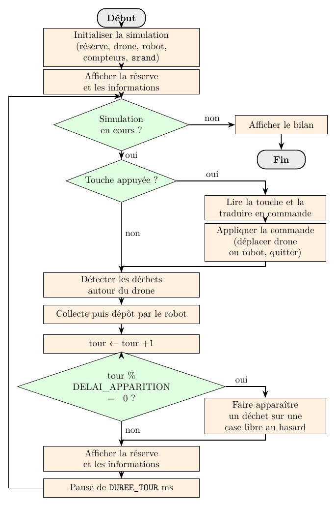
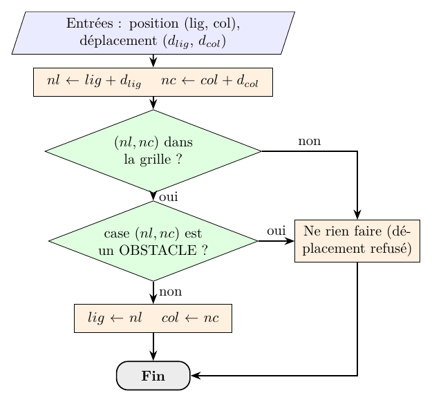
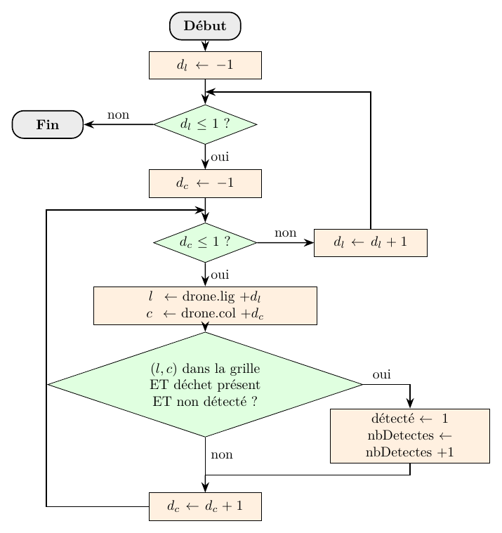
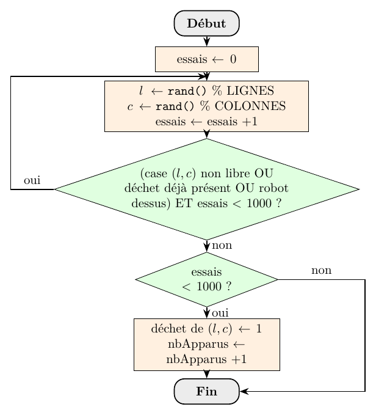
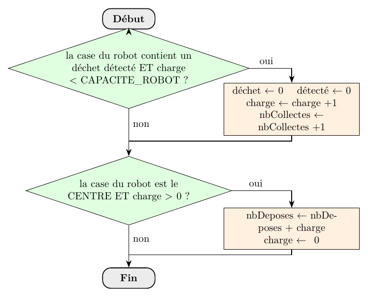
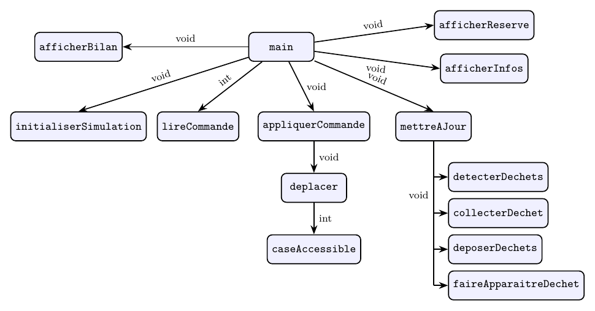

# Logigrammes

Le dossier complet est dans [EcoBots_rendu_mi-parcours.pdf](EcoBots_rendu_mi-parcours.pdf).

## Règles retenues

- Grille de 15 × 30 cases : zone libre, obstacle infranchissable ou centre de collecte. Un déchet est une information posée sur une case libre.
- Drone (touches **Z Q S D**) et robot (touches **I J K L**) se déplacent d'une case à la fois, jamais sur un obstacle ni hors de la grille. **X** pour quitter.
- Le drone détecte les déchets sur sa case et sur les 8 cases voisines. Un déchet non détecté est invisible.
- Le robot ramasse automatiquement un déchet **détecté** sous lui (3 au maximum), puis dépose tout au centre de collecte.
- Un déchet apparaît au hasard tous les 20 tours. Le clavier est lu sans bloquer (`kbhit` / `getch`).

## 1. Fonctionnement global de la simulation

## 2. Déplacer le drone ou le robot

Un seul algorithme pour les deux engins : il reçoit l'adresse de la position à modifier et le déplacement (−1, 0 ou 1 en ligne et en colonne).

## 3. Détecter les déchets autour du drone

Double boucle sur le carré 3 × 3 centré sur le drone.

## 4. Faire apparaître un déchet

Tirage au hasard d'une case jusqu'à en trouver une libre, avec un nombre maximal d'essais.

## 5. Collecte et dépôt par le robot

## 6. Graphe d'appels prévisionnel

